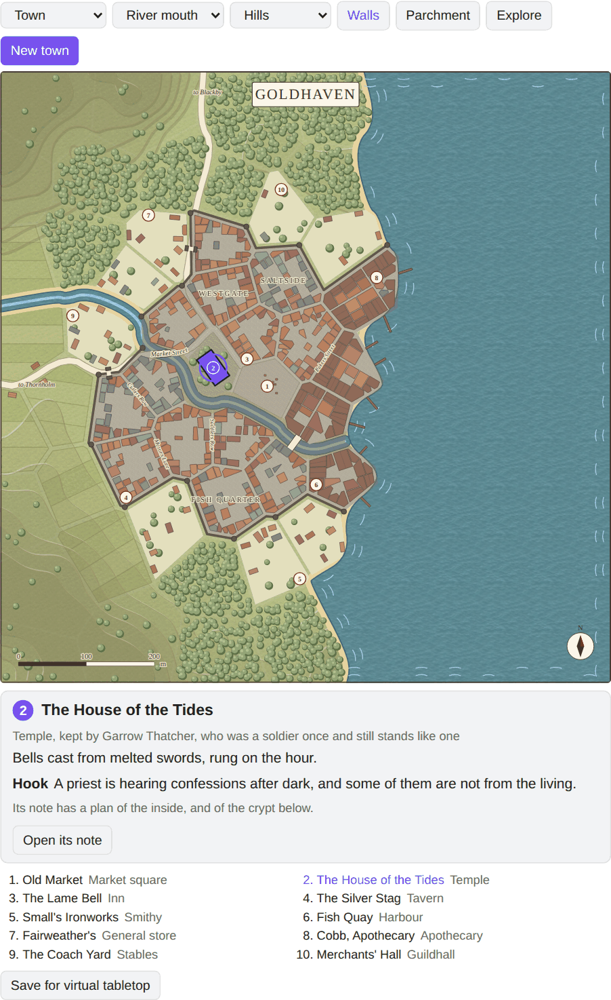
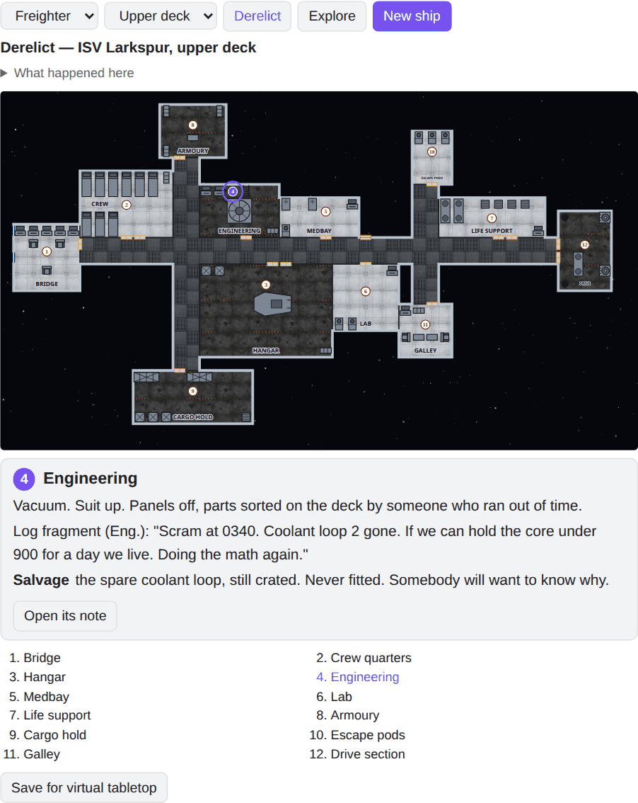
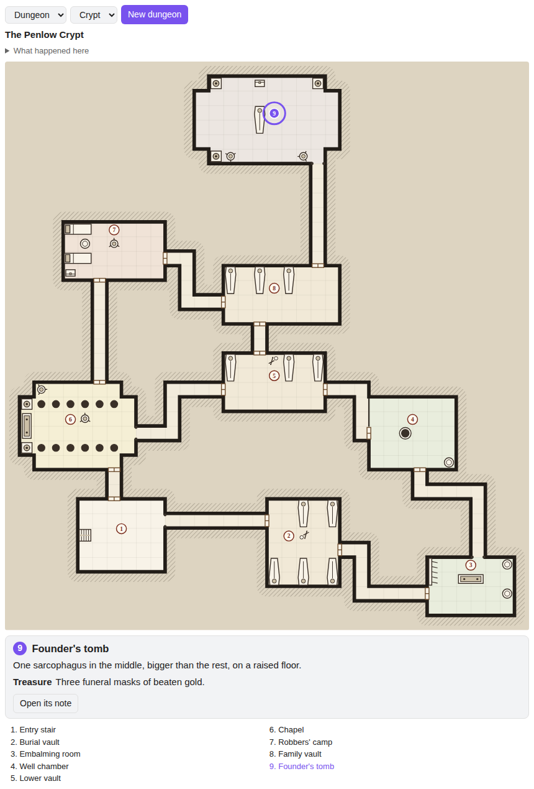
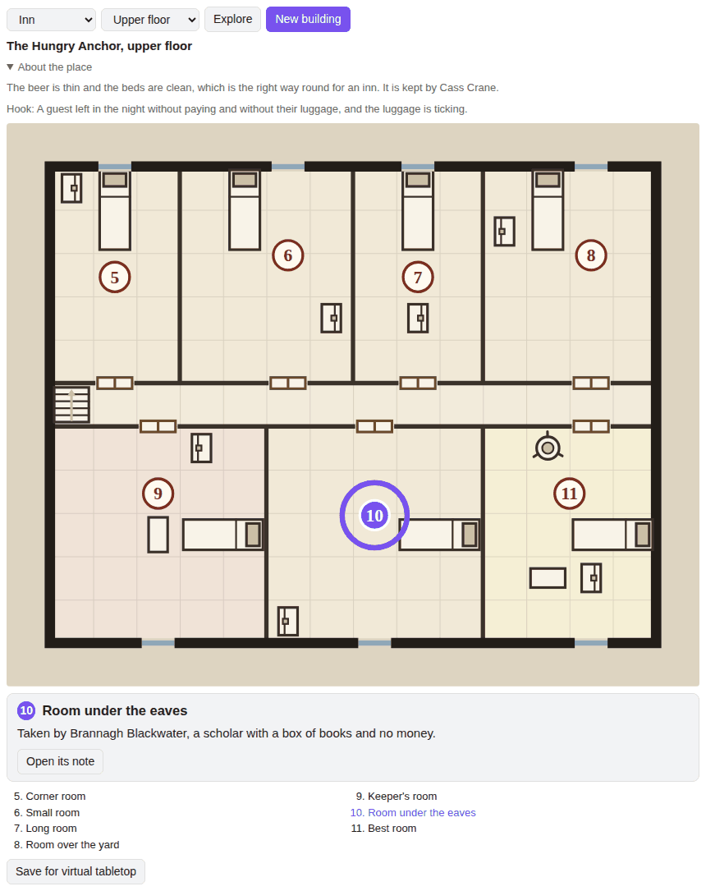

# Mapsmith

Town, ship and dungeon maps from a seed, drawn right in your notes, and the inside of every building in a town.



Put a `mapsmith` block in a note and you get a walled town, a river village or a harbour city, with its streets, wards, bridges, gates, docks, fields and woods. The same seed always draws the same town, so a map in your campaign notes never changes under you.

Every map has numbered places: the market, the temple, the inn, the smithy, the harbour and more. Click a number, or the building it sits on, to see the place's name, who keeps it, what it's like and a hook to start trouble with. **Open its note** writes a note for that place, in a folder named after the town, so you can keep writing about it. Every building gets a plan of its inside in that note too (see Inside buildings below), the keep gets a small keep to explore, and a temple has a crypt under it.

## Install

From Obsidian: Settings → Community plugins → Browse → search "Mapsmith", then Install and Enable.

By hand: copy `main.js`, `manifest.json` and `styles.css` from the latest release into `<your vault>/.obsidian/plugins/mapsmith/`, then enable it under Community plugins.

## Use

Open the command palette and run **Insert a town map**, **Insert a ship map**, **Insert a dungeon map** or **Insert the inside of a building**. Each one puts a `mapsmith` block with a new seed where your cursor is, and the map is drawn under it in reading view and live preview. The bar above each map changes it, and every change is written back into the block. Or type a block yourself, as below.

## The block

````
```mapsmith
seed: saltmarch
size: town
water: estuary
side: east
walls: yes
name: Saltmarch
```
````

| Key | What it does |
| --- | --- |
| `seed` | Any words. The same seed draws the same town. |
| `size` | `hamlet`, `village`, `town`, `large-town` or `city` |
| `water` | `none`, `river`, `coast`, `estuary` (a river into the sea) or `lake` |
| `side` | Where the sea or lake lies: `north`, `south`, `east` or `west` |
| `walls` | `yes` or `no`. Hamlets and villages never have walls. |
| `land` | `parchment` (the default) or `green`, for how the country around the town is painted |
| `terrain` | `flat` (the default), `hills` or `mountains`. Roads wind round high ground, rivers cut valleys through it, and mountains go to bare rock at the top. |
| `name` | The town's name. Leave it out and the seed picks one. |
| `explore` | Solo play in the town: the places you've walked to, `on` to start, or `off` to show the whole map. The **Explore** button writes it for you |

The bar above the map changes size, water, terrain, walls and land, and **New town** rolls a new seed. Each of them rewrites the block, so what you see is always what the note says. The command **Insert a town map** adds a block with a fresh seed.

The map is drawn in the colours of your theme, light or dark.

Press **Explore** to play the town on your own. You know the streets but not who is where: you start at place 1 (the market, or the inn in a hamlet), and every other number is gone. A question mark sits on the nearest places to the ones you've been to; click one to walk there, and its number, name and card appear, with what happened on the way: a quiet street, a rumour, some trouble, or someone you meet. The same walk always has the same thing on it. Where you've been is written into the block, so the note remembers it.

## Ships

Add `map: ship` and the block draws a spaceship's deck plan instead: rooms, corridors, doors, airlocks, hatches and the fittings in each room, numbered like a town's places.

````
```mapsmith
map: ship
seed: saltmarch
size: freighter
mood: derelict
```
````



| Key | What it does |
| --- | --- |
| `size` | `shuttle`, `corvette`, `freighter` or `station`. Freighters and stations have two decks. |
| `mood` | `intact`, a working ship with a crew aboard, or `derelict`, a wreck with a story of how it got that way, holes torn in the hull, hazards and salvage |
| `deck` | Which deck to draw, `1` or `2` |
| `explore` | Solo play, as on a dungeon (see Exploring alone below) |

Above the map is the ship's story, folded away until you open it. Click a room's number for what's in it; **Open its note** writes the room to a folder named after the ship. The bar changes size, deck and mood, and **New ship** rolls a new seed. The command **Insert a ship map** adds a ship block. **Explore** works on ships too: you come aboard through an airlock, or by the ladder from the deck before, and each compartment rolls what's aboard. Intact ships and derelicts have different lists.

## Dungeons

Add `map: dungeon` for a dungeon level: rooms joined by corridors, with plain doors, open arches, barred gates and the odd secret door (marked S), and fittings drawn in each room, from coffins and altars to racks and barrels.

````
```mapsmith
map: dungeon
seed: saltmarch
size: dungeon
kind: crypt
```
````



| Key | What it does |
| --- | --- |
| `size` | `lair` (4 to 6 rooms), `dungeon` (8 to 10) or `deep` (13 to 16, with stairs going further down) |
| `kind` | `crypt`, family vaults under the ground, or `keep`, a fallen stronghold: buildings in a walled yard, a tower on each corner and a barred gate |
| `explore` | solo play: the numbers of the rooms you've been in, such as `1, 3, 4`, `on` to start, or `off` to show the whole map. The **Explore** button writes it for you |
| `found` | solo play: the rooms where a search found the secret doors. The **Search for secret doors** button writes it |

Each room has a line on what's there, and some have a hazard or treasure; the room at the far end always has treasure. Above the map is the dungeon's story with a hook. **Open its note** writes a room to a folder named after the dungeon, and **New dungeon** rolls a new seed. The command **Insert a dungeon map** adds a dungeon block.

### Exploring alone

Press **Explore** to play a dungeon on your own. Only the way in can be seen (room 1 in a dungeon), with the corridors and open ground that lead out of it. Every other room stays dark. A question mark sits at each door into the dark; click it to go in, and that room, its number and its card appear. The card also says what you found inside: nothing, a sign of what's ahead, a trap, or something waiting for you, with the numbers growing in a deeper dungeon. Crypts and keeps have lists of their own, and a room always rolls the same thing, so it's still there when you come back. A secret door is plain wall in this mode until you find it: click a room you've been in and press **Search for secret doors** on its card. A 5 or 6 on a d6 finds any in that room's walls, and the door is drawn and opens like any other. What you've explored and found is written into the block (`explore:` and `found:`), so the note remembers how far you got. Press **Explore** again to see the whole map.

## Inside buildings

Add `map: building` for the floor plan of one building, numbered and furnished room by room: an inn's common room, kitchen, store and snug, with guest rooms upstairs and who is staying in them, and a cellar under it; a tavern, with a cellar too; a shop with its workroom; a smithy open to the street; a temple with its nave, sanctuary and a stair down to the crypt; a guildhall with its strongroom; a bathhouse; a library; the watch's barracks and cells; a livery stable with a hayloft; a playhouse; or a mill. Most have an upper floor, reached by the stairs in the front room's corner. An inn's or a tavern's cellar is down a ladder from the store room: casks, a wine cellar with a grating to the street, and an old cellar with something hidden in it. A place's note from a town map has this block in it already, with the place's name and keeper.



````
```mapsmith
map: building
seed: saltmarch
kind: inn
```
````

| Key | What it does |
| --- | --- |
| `kind` | `inn`, `tavern`, `shop`, `smithy`, `temple`, `guild`, `bathhouse`, `library`, `barracks`, `stables`, `theatre` or `mill` |
| `deck` | the floor to show, `1` for the ground floor, `2` for upstairs and `3` for an inn's or a tavern's cellar |
| `name` | the building's name; without it one is made up |
| `keeper` | who keeps it; without it one is made up |
| `explore`, `found` | solo play, as in a dungeon. Upstairs, you come in at the top of the stairs, and in a cellar at the foot of the ladder |

Above the plan is what the place is known for, and a hook. One room in each building hides something. **New building** rolls a new seed, and the command **Insert the inside of a building** adds a block.

## Pro

Everything above is free. Mapsmith Pro will be a one-time payment of $6 on itch. It isn't on sale yet, and this section will link to it when it is. It adds a **Save for virtual tabletop** button under every town, dungeon, ship and building plan. It writes a Universal VTT file (`.dd2vtt`) beside your note: the map as your players should see it, with no numbers and secret doors drawn as plain wall, plus the walls, doors, windows and lights already placed. In a town every building and the town wall are walls and the gates are doors, on a grid of five metres a square (ten on a large town or city). Roll20 imports it as it is, and Foundry reads it with the Universal Battlemap Importer module.

After you buy, copy your download page's address. Paste it into Mapsmith's settings under **Pro key** and press **Check**. Pro stays on in that vault from then on. Lost it? Type the email you bought with under **Lost your key?**.

## Privacy

Mapsmith has no accounts and collects nothing. Maps are drawn on your device from the seed. It goes online only when you press **Check** or **Mail my key** in its settings. Check sends the Pro key you pasted to this plugin's server (bulkhead.bananafest-destiny.com), which asks itch whether the key is real; the server keeps a hash of a good key, never the key. Mail my key sends the email you typed to the same server, which asks itch for that address's key and mails it there; it keeps only a hash of the address, so it mails no more than once an hour. Nothing else ever leaves your vault. Opening a room's note writes a new note, and saving for a virtual tabletop writes a `.dd2vtt` file beside the map's note.

## Licence

MIT
